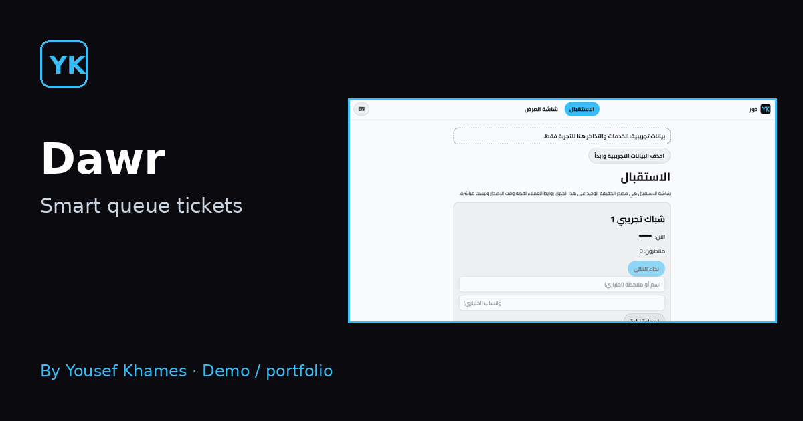

<div align="center">


# dawr

**dawr** · demo / portfolio project

**تذاكر دور ذكية** · مشروع تجريبي للعرض

[Live demo](https://yousefkhames.github.io/dawr/) · By Yousef Khames · من تطوير يوسف خميس



</div>

---

# dawr · دَور

A white-label queue ticket kit for clinics, pharmacies and shops. Reception issues numbered tickets per service or doctor, calls the next number, and can show "now serving" on a TV or tablet. Each ticket has a QR link that tells the customer how many people were ahead when the link was made. Arabic RTL and English LTR. Static HTML, CSS and JavaScript. No build, account, server, API or payment.

<div lang="ar" dir="rtl">تذاكر طابور للعيادات والمحلات. الاستقبال يصدر تذكرة برقم ورابط QR، والعميل يعرف كم شخصًا قبله. بدون سيرفر.</div>

 **By Yousef Khames · من تطوير يوسف خميس**

## Features

- Reception (`#/reception`): services or doctors, issue ticket (optional name or note and WhatsApp number), call next, done, no-show, skip and bring back, ticket slip with QR, print.
- Display (`#/display`): large "now serving" per service for a TV or tablet. It updates by itself, in a second window of the same browser, or cast from the reception device.
- Ticket link (`#/t/...`): customer sees the number, how many are ahead, and the time the status was taken.
- Optional WhatsApp draft "your turn is near" with a fresh link. The app only opens a draft; you press send.
- Stats from recorded timestamps only. Average wait and service time show "not enough data" until 3 recorded tickets exist. The customer estimate in minutes appears only when the link carries a recorded average service time.
- CSV export, JSON backup and restore, "new day" reset. No medical data fields.

## Preview locally

```sh
python3 -m http.server 8080 --bind 127.0.0.1
```

Open `http://localhost:8080/`. Shipped in demo mode: services are labelled Demo and a button clears demo data. Screenshots in `docs/` use demo data only.

## Set up

1. Edit `config.js`: `shopId`, `services`, and `demo: false` to start clean. Theme in `assets/kit-theme.js`. Keep `assets/yk-logo.svg` and `assets/favicon.svg`.
2. Reception uses one browser on one device. Open the published page there. Customers only receive ticket links.
3. Ticket QR codes must be made from the published page (https), not from localhost.

## Deploy (GitHub Pages)

Create `yousefkhames/dawr`, commit to `main`, Settings → Pages → Deploy from a branch → `main` / root. Live at `https://yousefkhames.github.io/dawr/`.

## Tests

```sh
npm test        # unit + review gates + headless Chrome e2e (Node 20+)
```

## Honest limits

- **One reception device is the source of truth.** Data lives in that browser's local storage. Clearing site data erases the queue; use Backup.
- **Customer views are snapshots, not live.** The link shows the state when it was made. To refresh, the customer scans a new slip or opens a newer link you send (copy link or WhatsApp draft). The "ahead" count does not drop by itself.
- The display screen reads the same browser's storage; it does not work on a different device unless you cast the screen.
- The minute estimate is the recorded average service time times people ahead. It is rough, and absent until enough tickets are recorded.
- Ticket links hold only the number, service name and counts. The name or note and phone you type stay on the reception device (the phone is used only to open a WhatsApp draft).
- Do not enter medical or sensitive personal data. This kit is not a medical record system.
- The clock of the reception device is used for all timing.

## License

MIT, copyright Yousef Khames. See `LICENSE`. Cairo font: SIL OFL. `assets/qrcode.js`: qrcode-generator by Kazuhiko Arase (MIT).

> Demo / portfolio project. Static GitHub Pages site with fictional sample data, not a certified queue or booking system.
