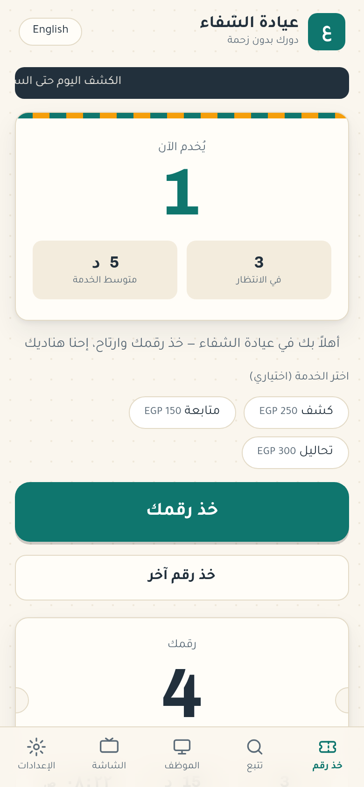
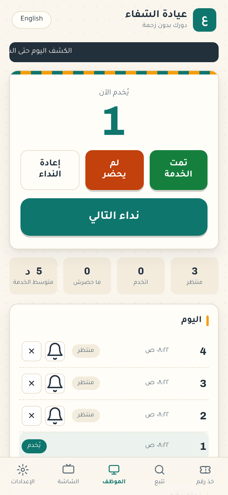
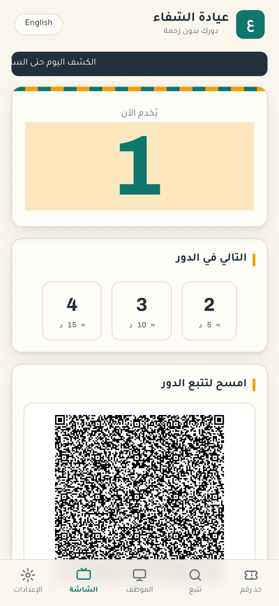
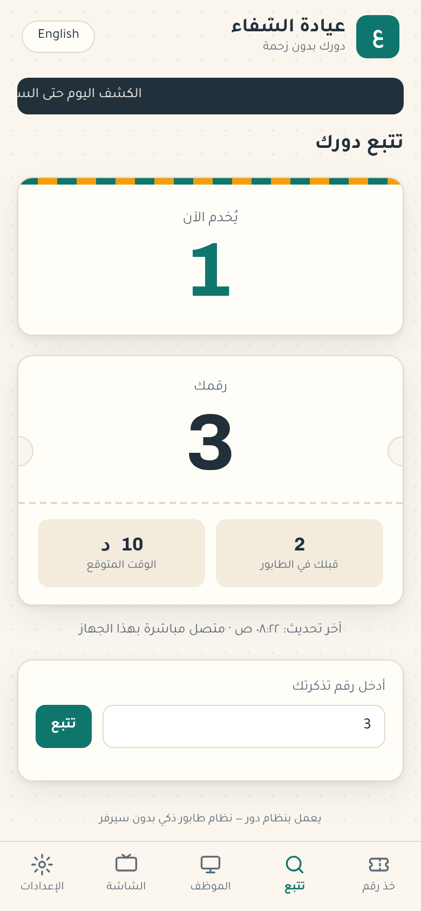

<p align="center">
  
</p>

<h1 align="center">Dawr · دور</h1>

<p align="center">
  <b>White-label smart queue tickets for clinics, labs and offices — no server needed.</b><br>
  نظام طابور ذكي للعيادات والمعامل والمكاتب، يعمل كاملاً بدون سيرفر
</p>

<p align="center">
  <a href="https://yousefkhames.github.io/dawr/"><b>▶ Live demo · جرّب التطبيق</b></a>
</p>

---

## The idea · الفكرة

A clinic, lab or office runs the whole queue from **one device** (the reception phone, tablet or PC). Customers take a number on that device at the door, watch a big waiting screen, and track their turn on their own phones through a **QR code / link that carries a snapshot of the queue** — no backend, no accounts, no subscription.

عيادة أو معمل أو مكتب يشغّل الطابور كله من **جهاز واحد**. العميل ياخد رقم من نفس الجهاز عند الباب، يتابع شاشة الانتظار الكبيرة، ويتابع دوره من موبايله عن طريق **رمز QR / لينك يحمل صورة لحظية من الطابور** — بدون سيرفر أو حسابات أو اشتراكات.

## Screenshots

<p>
  
  
  
  
</p>

## Features · المميزات

- **Take a number kiosk** — big friendly button, optional service selection with prices, printable ticket stub with perforated design.
- **Staff control panel** — call next, done, no-show, recall, call any number, cancel, reset the day. Live stats: waiting, served, no-shows, average service time.
- **Waiting display screen** — huge "now serving" number, next-in-line chips with per-number wait estimates, announcement ticker, sound chime + optional spoken number (Web Speech), auto-updating QR for customers.
- **Customer tracker** — scan the QR on the display (it refreshes with every call) to see "now serving", your position, and a live wait estimate that keeps counting down between scans.
- **Smart wait estimates** — starts from your configured average service time, then *learns* the real average from the last 12 finished visits (no-shows excluded).
- **White-label settings** — business name (Arabic + English), logo upload, brand colors, default language, welcome message, announcement bar, ticket note, currency, services with prices, number prefix and starting number. Export/import the whole branding as a JSON file, or share it as a link.
- **Same-device live sync** — staff, kiosk, display and tracker tabs sync instantly via `BroadcastChannel` + `localStorage`.
- **Arabic & English** — full RTL/LTR support, one-tap toggle, Arabic-first defaults.
- **CSV export** — download the day's tickets with timestamps and service durations.
- **Installable** — PWA manifest, works offline after first load, mobile-first.

## How the "no server" sync works · إزاي بيشتغل بدون سيرفر

1. **Same device** — all screens share state through `localStorage` and sync live through `BroadcastChannel`.
2. **Customer phones** — the display/staff screen shows a QR code whose link encodes a compact, base64url **snapshot** of the queue (now-serving, waiting list, learned average, timestamp). The customer page dead-reckons the countdown from that snapshot, so the estimate keeps ticking between scans. Every call updates the QR, so a rescan is a refresh.
3. **Branding links** — the whole white-label configuration is encoded into the customer link itself (`#/ticket?cfg=…`), so a shared link opens with the business's name, colors, logo and language.

## Honest limits · حدود حقيقية

- **No true cross-device push.** Without a server, a customer phone cannot receive live updates by itself — it refreshes by rescanning the QR (the estimate counts down locally in between). For most walk-in queues this is enough; a hosted backend would be needed for remote booking.
- **Numbers are issued on the business device.** Two customers can't take numbers from their own phones simultaneously (numbers would collide); they track on their phones, they take at the door.
- **Data lives in the browser** of the business device (`localStorage`). Clearing site data resets the queue. Export CSV/JSON for backup.
- **Announcements are recorded clips**, bundled in `audio/` (Arabic and English, numbers 0 to 999, letters A-Z and Arabic letters for the ticket prefix), so every phone sounds the same. Clips were generated once with Gemini text-to-speech (Erinome for Arabic, Kore for English; `tools/gen-audio.py` is the legacy edge-tts script) and are not a human recording. They have not been checked by a native speaker. Ticket numbers above 999, or a prefix with other symbols, fall back to the browser's own voice.
- Fonts (Tajawal, Chivo Mono) are bundled in `fonts/`, so the app makes no third-party requests.

## Tech · التقنيات

- Vanilla HTML/CSS/JS, zero build step, zero dependencies at runtime (except a vendored MIT QR generator, [`qrcode-generator`](https://github.com/kazuhikoarase/qrcode-generator)).
- Pure queue engine (`js/queue.js`) separated from the UI and unit-tested in Node.
- Tests: `node --test tests/queue.test.cjs` (16 unit tests) plus a Puppeteer click-through suite (`tests/e2e.cjs`, 19 checks) covering ticketing, calling, estimates, branding, i18n, visitor links and cross-tab sync.
- Hosted free on GitHub Pages.

## Run locally · التشغيل محلياً

```bash
python3 -m http.server 8000
# open http://localhost:8000
```

Open `#/staff` for the control panel, `#/take` for the kiosk, `#/display` for the waiting screen, `#/settings` for white-labeling.

## License

MIT — see [LICENSE](LICENSE).

## Round 2 review notes
- Added a service worker: the app shell and the self-hosted fonts are precached, and chime audio is cached the first time it plays, so the display screen keeps working offline after one visit.
- The copy fallback now reports a failure instead of saying "copied".
- Limit: a queue lives in the browser (and share links), there is no server, so other devices only see what is in the shared link/QR.
